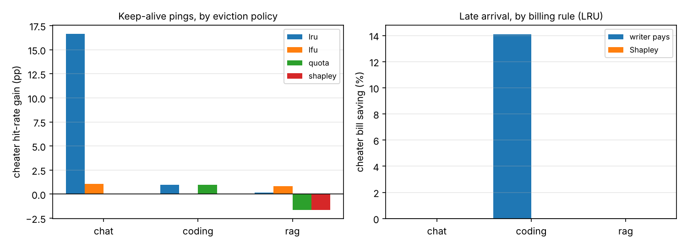
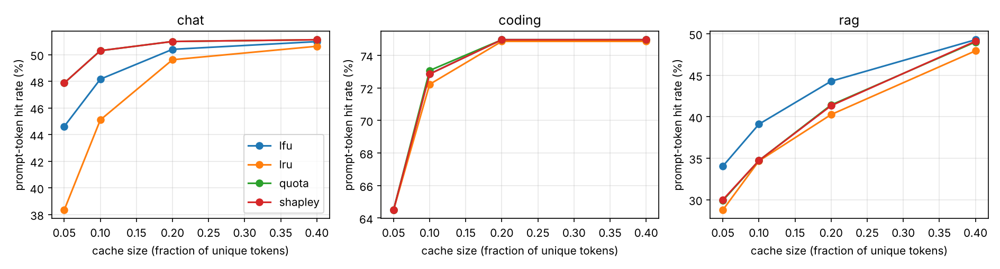

# fair-prefix-cache

**Fair cost-sharing and eviction for shared prefix KV caches in multi-agent LLM systems.**

Agent workflows resend the same long prefixes (system prompts, tool specs,
documents, history) on every call. Servers cache the KV states of those
prefixes, and API providers bill cached tokens at a discount. When several
agents or tenants share one cache, two questions have no standard answer:

1. **Billing** - who pays for a prefix that many agents reuse?
2. **Eviction** - when memory is full, whose prefixes go, and can an agent game the rule?

This repo models the cache as a **cooperative cost-sharing game**, bills each
agent its **Shapley value**, and evicts by **Shapley share of memory**. It
compares these against LRU, LFU, a writer-owns quota, and common billing rules,
on synthetic multi-agent traces, including **strategic agents** that try to
free-ride.

## Quick start

```bash
python -m venv .venv && source .venv/bin/activate
pip install -e ".[dev]"
pytest -q                                  # 19 tests, < 1 s
python -m experiments.run_sweep            # ~6 s, writes results/*.csv
python -m analysis.plots                   # writes results/fig_*.png
```

Optional, real model on Apple Silicon (PyTorch MPS):

```bash
pip install -e ".[model]"
python -m engine.model --calibrate         # prefill tokens/s on your Mac
python -m engine.model --demo              # KV prefix reuse: speed-up + exactness check
python -m experiments.run_sweep --prefill-tps <your number>
```

## The game

Agents are players. A *record* is one computation of a token run in the cache,
with the set of agents that used it while it was cached. With the cache history
fixed, a coalition S needs every record some member of S used:

```
C(S) = sum over records r with users(r) ∩ S ≠ ∅ of cost(r)
```

This is a sum of union games, so the Shapley value has a closed form: **each
record's cost is split equally among its users**. `tests/test_gametheory.py`
checks the closed form against brute-force Shapley and verifies the allocation
is in the core (no group of agents would rather run its own cache).

## Starter results (synthetic traces, default settings)



- **Late arrival** (wait for others to compute the shared prefix): saves the
  cheater ~14% under writer-pays billing on the coding workload, **0% under Shapley billing**.
- **Keep-alive pings** (keep your own prefix hot): +16.6 pp hit rate for a light
  chat tenant under LRU, **0 under Shapley-share or quota eviction**.



These are first numbers from simple synthetic workloads - the project's job
is to make them robust (more seeds, realistic traces, a real model).

## Layout

```
engine/       radix_cache.py (prefix tree + usage records), simulator.py, model.py (HF / MPS)
policies/     eviction.py (lru, lfu, quota, shapley), billing.py (5 rules)
gametheory/   shapley.py (exact, closed form, Monte Carlo), core_check.py, strategic_agents.py
workloads/    trace.py (format, JSONL), agents.py (coding team, RAG, multi-tenant chat)
experiments/  run_sweep.py
analysis/     plots.py
tests/        cache invariants, Shapley maths, billing balance, cheater results
```

## Roadmap (3 weeks)

- [x] Day 1-6: radix prefix cache, LRU eviction, simulator, workloads
- [ ] Day 2: calibrate prefill tokens/s on the MacBook (`engine.model --calibrate`)
- [ ] Day 7-9: baseline sweeps, multiple seeds, confidence intervals
- [ ] Day 10-14: Shapley billing and eviction; decay users over a time window
- [ ] Day 13-16: smarter cheaters (padding, Sybil agents), memory-time cost in the bill
- [ ] Day 16-18: full sweep; real-model run of one workload end to end
- [ ] Day 19-21: report, demo GIF, blog post

## References

vLLM / PagedAttention (SOSP 2023) · SGLang / RadixAttention (2024) ·
Prompt Cache (MLSys 2024) · Fairness in Serving LLMs (OSDI 2024) ·
FairRide (NSDI 2016) · Dominant Resource Fairness (NSDI 2011) ·
Shapley, *A Value for n-Person Games* (1953).

## License

MIT
# fair-prefix-cache
